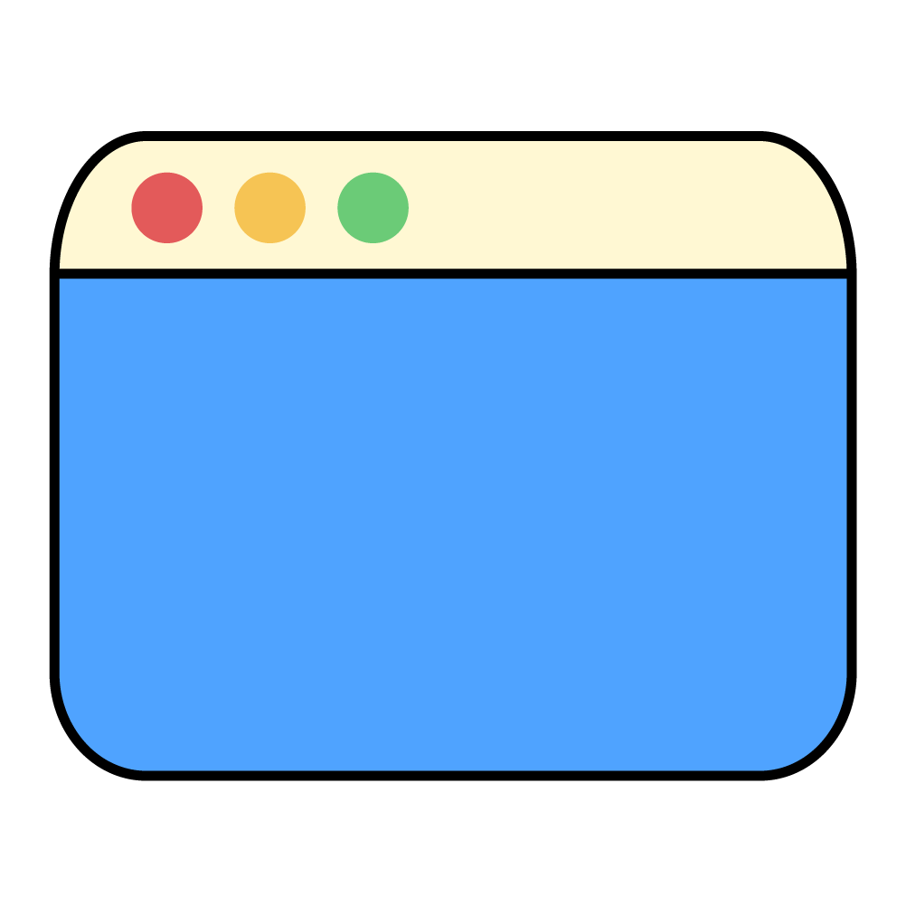

  

<h1 align="center">CleanTab</h1>

<i>A CleanTab for a ClearMind.</i>

**CleanTab** is a free, privacy-first Chrome extension that helps you stay away from NSFW and distracting content.  
Unlike most blockers, CleanTab scans *inside* your active tabs (like Reddit, Twitter, or image-heavy sites) to detect unsafe or explicit visuals — and gently redirects you before you spiral.

> 🧩 A CleanTab for a ClearMind.

---

## 🌿 Why I Built This

I built CleanTab as a personal mission to fight online distractions and unhealthy habits.  
I realized that most “NSFW blockers” only work on URLs — but not on what’s actually *displayed* inside a tab.

CleanTab changes that.  
It looks at what’s visible on your screen (not your history or private data) and helps you protect your focus, your productivity, and your peace of mind.

This project is completely free and open for anyone who wants to reclaim their attention and mental clarity.

---

## ✨ Features

- 🔍 **Smart Detection** — scores page text, titles and links, and checks pictures you linger on (never ones you scroll past; one picture alone never blocks a page).  
- 🎚 **Three sensitivity levels** — tune how much signal it needs before blocking, instead of turning it off.  
- 🚫 **Friction where it counts** — a block you think is wrong can be re-checked (words and pictures, on your device) and a clean page opens. Opening a page that does not check out waits first, counts against the day, and respects your lock. Nothing gets looser on a click; getting stricter is instant. You can also block sites yourself.  
- 🌱 **Forgiving progress** — a ring and a plant that count how many of the last 14 days were protected. A slip lowers it by one; nothing resets to zero.  
- 🎯 **Focus mode** — close streaming (Netflix, YouTube, Twitch…) and endless feeds (TikTok, Instagram, X, Reddit, Shorts…) for 25, 50 or 90 minutes, or on a weekly schedule. Any closed site can be opened for five minutes, three times a day, and focus never counts against your protected days.  
- 📋 **Nothing hidden** — every trusted site is listed and removable; the popup shows what's happening on the current tab.  
- 🧩 **Local-first** — model weights and fonts ship with the extension. No CleanTab servers, no analytics, no accounts. The only requests it makes are to the sites you are already visiting: fetching an image you dwelled on, or re-fetching a blocked page when you ask it to review that site.  
- 🧘 **Mindful Interface** — clean design, gentle feedback, and focus reminders.  
- ❤️ **Open Source** — contribute, customize, and make it yours.

---

## 🧭 How It Works

1. CleanTab reads the page you open, on your device.  
2. When it looks explicit (a known adult site, the page's own text and links, or optionally the images you linger on), the tab is replaced with a pause screen.  
3. The pause screen asks what's going on, offers a breath, and always has a way through if the block was wrong.  
4. During a focus session, streaming and feed sites get the same screen with the time left instead.

---

## 🚀 Installation

### Option 1 — From Chrome Web Store (coming soon)
> _Link will be added after public release._

## ⚙️ Tech Stack

- **Manifest v3** (Chrome Extension)  
- **JavaScript** (no build step)  
- **HTML + CSS** (Popup + Redirect Page)  
- **Local Storage API** for settings  
- **NSFW.js + TensorFlow.js** bundled locally (MobileNetV2, ~2.7 MB) in an offscreen document  

---

## 💬 Future Plans

- [ ] SafeSearch / Restricted Mode enforcement  
- [ ] A remote code for accountability partners (no server)  
- [ ] Cross-browser support (Firefox, Edge)  
- [ ] Community-submitted “clean lists”  

There are no analytics and none are planned.

---

## 💖 Support the Project

CleanTab is free and open-source, built from a real struggle with distraction and NSFW habits.  
If this project helps you, consider supporting it:

☕ [**Buy Me a Coffee**](https://Ko-fi.com/ilyasstoubbali)  
💸 [**PayPal.me/ilyasstoubbali**](https://paypal.me/ilyasstoubbali)

Your support helps me keep improving CleanTab — and helps others find clarity online.

---

## 📜 License

MIT License © 2025 [**Ilyass Toubbali**](https://github.com/ToubbaliIlyass)  
Feel free to use, modify, and share with credit.

---

## 🌐 Links

- 💻 [**GitHub Repo: CleanTab**](https://github.com/ToubbaliIlyass/CleanTab)  
- 📬 **Contact:** toubbaliilyasse@gmail.com 
- 📸 [**Instagram: @ilyasstoubbali**](https://instagram.com/ilyasstoubbali)  

---

> “Clean your tabs, clear your mind. Every click can be a choice toward focus.” 🌿
